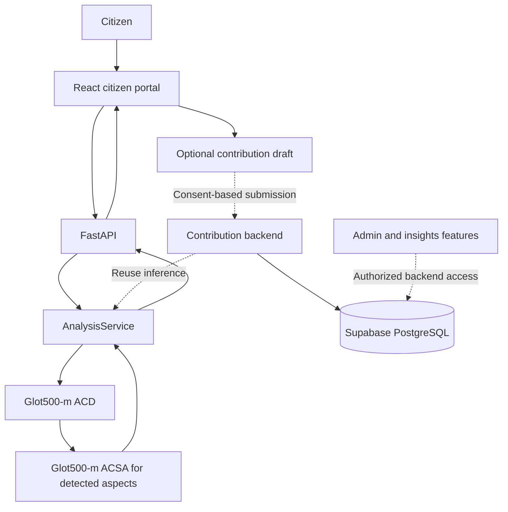

# System architecture

[Back to repository README](../README.md)

## Overview

The application separates the citizen-facing interface, HTTP API, model inference, and persistent data. The research training repository is not a runtime dependency of the web repository.



Solid analysis-path arrows describe the implemented inference workflow. The contribution and administrative persistence paths describe integration boundaries; confirm teammate implementations before treating them as complete.

## Repository organization

```text
citi-senti-web/
├── backend/
│   ├── app/
│   │   ├── main.py                 # FastAPI application and router registration
│   │   ├── ml/
│   │   │   ├── labels.py            # Research taxonomy
│   │   │   ├── absa_runtime.py      # Checkpoint loading and inference
│   │   │   └── service.py           # Configuration and orchestration
│   │   └── routers/analysis.py      # HTTP contract
│   ├── scripts/                    # Verification and development data tools
│   ├── tests/                      # Model service and API tests
│   ├── model_artifacts/            # Local, ignored by Git
│   ├── .env.example
│   ├── requirements.txt
│   └── requirements-model.txt
├── frontend/
│   ├── public/                     # Local SVG assets and icon symbols
│   ├── src/
│   │   ├── components/             # Shared layout and results components
│   │   ├── data/aspects.ts          # UI taxonomy and descriptions
│   │   ├── pages/                  # Route-level interfaces
│   │   ├── services/               # HTTP clients and result helpers
│   │   └── App.tsx                 # Router
│   ├── scripts/verify-explore.mjs
│   ├── package.json
│   └── pnpm-lock.yaml
├── supabase/migrations/             # PostgreSQL schema and reference data
├── docs/
└── README.md
```

This tree highlights the analysis feature and shared foundations, not every file. Local artifacts and environments are intentionally absent from version control.

## Routes and integration status

| Route | Purpose | Inspected implementation |
| --- | --- | --- |
| `/` | Entry point | Redirects to `/analyze-feedback` |
| `/analyze-feedback` | Input and results | Live analysis workflow; results replace input without a route change |
| `/contribute-feedback` | Consent-based contribution | Placeholder in the inspected route; draft handoff provided |
| `/public-insights` | Aggregated statistics | UI and API client present; corresponding backend not in the inspected snapshot |
| `/explore` | Explore entry | Redirects to `/explore/aspects` |
| `/explore/aspects` | Aspect reference | Implemented |
| `/explore/how-it-works` | Workflow and limitations | Implemented |
| `/explore/about` | Research overview | Implemented |
| `/admin/login` | Administrator sign-in | UI and API client present; authentication backend not in the inspected snapshot |

Only `GET /api/v1/health` and `POST /api/v1/analysis` are registered in the inspected backend. Frontend clients anticipate `GET /api/v1/insights/filters`, `GET /api/v1/insights`, and `POST /api/v1/admin/login`; these are not verified live endpoints in that snapshot. Update this table after integrating teammate branches. Do not implement alternate endpoints solely to match documentation.

## Analysis implementation responsibilities

| Module | Responsibility |
| --- | --- |
| `frontend/src/pages/AnalyzeFeedbackPage.tsx` | Input, sample selection, character validation, loading and error states, temporary result state |
| `frontend/src/services/analysis.ts` | HTTP request, response validation, types and samples |
| `frontend/src/components/AnalysisResults.tsx` | Sentiment counts, detected aspects, conditional truncation notice, copy, clear and contribution navigation |
| `frontend/src/services/analysisResults.ts` | Result sorting, summaries, warning and clipboard formatting |
| `frontend/src/components/AnalysisFlowContext.ts` | Temporary contribution draft and results header state |
| `frontend/src/components/Layout.tsx` | Citizen shell, context provider and dynamic topbar |
| `backend/app/routers/analysis.py` | Pydantic request and response validation, dependency injection and HTTP error mapping |
| `backend/app/ml/service.py` | Model configuration, lazy loading, orchestration, concurrency lock and structured output |
| `backend/app/ml/absa_runtime.py` | Model/tokenizer loading, device selection, tokenization and inference operations |

## Data flow and ownership

1. The citizen submits a nonblank comment with at most 1,000 Unicode code points.
2. The browser sends JSON to the analysis API; the backend independently validates the request.
3. `AnalysisService` loads the models on demand and performs ACD followed by ACSA for detected categories.
4. The backend returns validated predictions and truncation metadata. The frontend computes display counts and resolves names from its taxonomy.
5. Results remain temporary; Copy Results and Clear do not write to PostgreSQL.
6. Submit Feedback transfers only the comment to the contribution route. The contribution feature must independently validate consent and persist authoritative results through the backend.

The backend inference service, not the browser, is authoritative for predictions used in persistent records. Do not expose PostgreSQL credentials to the frontend. Policy topics are application-level grouping labels and are separate from model-predicted aspects.

## Deployment boundary

The development proxy, model loading modes and database migrations are foundations, not a complete production deployment. A deployment must address reverse proxy routing, SPA fallback, HTTPS, authentication and authorization, memory limits, worker count, request size/rate limits, timeouts, and logging/privacy. The inference lock and resident model handles are process-local: multiple workers can load separate model copies. Evaluate capacity using the actual target environment before exposing the API publicly.

See [Analysis developer guide](ANALYSIS_DEVELOPMENT.md), [Database](DATABASE.md), and [Testing](TESTING.md).
