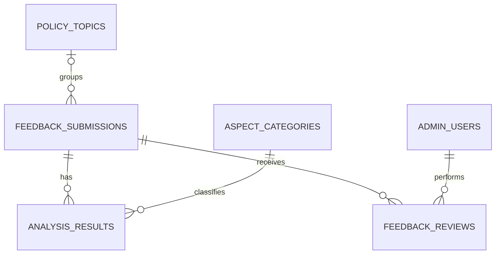

# Database and migrations

[Back to repository README](../README.md)

CITI-Senti uses Supabase-hosted PostgreSQL for persistent data. Temporary citizen analysis does not require a database connection. The application is designed for React → FastAPI → PostgreSQL, rather than direct browser access to private database tables.

## Environments

Maintain separate development and production Supabase projects. Use development credentials for local application testing, migrations and approved research seed data. `APP_ENV` is an environment label, not an automatic database switch: the actual target is selected by `DATABASE_URL` or the linked Supabase CLI project. Never commit passwords, database URLs or project-specific local CLI state.

Use the development Session pooler connection string from the Supabase dashboard. The seed script specifically requires the Session pooler on port 5432 with SSL enabled, user `postgres.<DEV_PROJECT_REF>` and database `postgres`. See [local development](LOCAL_DEVELOPMENT.md) for the environment variables.

## Schema

The committed SQL migrations are the authoritative definition for the inspected database version. Use lowercase PostgreSQL table and column names.

| Table | Key | Purpose |
| --- | --- | --- |
| `admin_users` | `user_id` | Administrator identity and password hash |
| `policy_topics` | `topic_id` | Optional predefined topic grouping |
| `aspect_categories` | `aspect_code` | Research taxonomy A01–A11, descriptions and examples |
| `feedback_submissions` | `submission_id` | Source, reference code, original/current text, revision, policy/language information, consent/access credentials, analysis and moderation state |
| `analysis_results` | `(submission_id, aspect_code)` | Latest per-aspect sentiment predictions and associated comment revision |
| `feedback_reviews` | `review_id` | Moderator actions, old/new values, notes and audit information |



Enums:

| Type | Values |
| --- | --- |
| `feedback_analysis_status` | `pending`, `processing`, `completed`, `failed` |
| `feedback_moderation_status` | `pending_review`, `approved`, `flagged`, `hidden` |
| `sentiment_type` | `positive`, `neutral`, `negative` |
| `feedback_source` | `citizen_submission`, `research_corpus` |

Important invariants from the migrations:

- Original and current comments are nonblank and at most 1,000 characters; revision numbers are positive.
- `reference_code` is unique. Citizen submissions require consent timestamp, consent notice version and access-code hash. Research corpus records require these three fields to be null.
- `analysis_results` stores rows, not a JSON predictions object. The sentiment column is nullable in the schema; successful live inference returns a non-null sentiment for every detected aspect.
- Results represent the current revision, not a history of all predictions. The contribution backend must invalidate stale results when comments change and ensure inserted results refer to the revision that was analyzed. Analysis status, analyzed timestamp and model version are stored on the submission.
- Policy topics are optional and distinct from the eleven model aspect categories.
- Row-level security is enabled and grants to Supabase API roles are revoked for the six tables in the initial migration. This does not replace server-side authentication and authorization for direct PostgreSQL connections.

## Apply migrations

The inspected repository includes:

| Migration | Purpose |
| --- | --- |
| `20261123145224_init_citi_senti_schema.sql` | Initial tables, enums, constraints, indexes and access restrictions |
| `20261124123916_add_feedback_source.sql` | Research/citizen source distinction and credential requirements |
| `20261124124934_seed_reference_data.sql` | Fifteen policy topics and eleven aspect categories |

From the repository root, with Supabase CLI installed and access to the development project:

```bash
supabase login
supabase link --project-ref <DEV_PROJECT_REF>
supabase db push --dry-run
```

Replace `<DEV_PROJECT_REF>` with the actual value (without angle brackets). Confirm the linked project and pending migrations before running:

```bash
supabase db push
```

Do not run this against production as part of routine local setup. If the development database is already provisioned, coordinate with the team before applying further migrations. Add new timestamped migrations for schema changes instead of editing migrations already applied to shared environments. Review migration diffs and dry-run output; a dry run is not a substitute for testing on development.

## Verify connectivity

From `backend/`, with the virtual environment active:

```bash
python -m scripts.check_database
```

The script checks for the six expected public tables. In the original snapshot it loads `.env` beside the script, even though `.env` belongs in `backend/`. If that original version is still present, update the loader to `load_dotenv(Path(__file__).resolve().parents[1] / '.env')` before using it. If your branch already fixes this, no change is needed. Never duplicate `.env` into `scripts/` merely to make the check work. A table count of six is a connectivity check, not a verification of every migration or column.

## Seed approved research feedback (development only)

`backend/scripts/seed_research_feedback.py` imports a private CSV with exactly one header, `model_text`. It validates nonblank text, length, and duplicates; it generates deterministic `DEMO-` reference codes, inserts source `research_corpus` and leaves records at their default analysis/moderation state. It does not run model inference, approve feedback, or populate statistics on its own.

Ensure the dataset is authorized for this use and appropriately de-identified. Keep the CSV in an ignored local directory. From `backend/`:

```bash
python scripts/seed_research_feedback.py seed_data/citi_senti_unique_model_text.csv
```

This is a dry run (no database connection or writes). Review the unique comment count. When ready, and only on the development database:

```bash
python scripts/seed_research_feedback.py seed_data/citi_senti_unique_model_text.csv --apply
```

Enter the development project reference when prompted. The script rejects production or nonmatching pooler configuration, performs inserts transactionally and skips matching existing references. The actual file and credentials are not distributed with the web repository. Do not use research records as if they were voluntary citizen submissions; preserve provenance and clearly distinguish sources in any public reporting. Bulk analysis and eligibility for Public Insights require a separate, reviewed workflow.

## Confirm temporary analysis isolation

Run the following read-only query on an otherwise idle development database before and after temporary analysis requests:

```sql
SELECT
    (SELECT COUNT(*) FROM public.feedback_submissions) AS feedback_count,
    (SELECT COUNT(*) FROM public.analysis_results) AS analysis_count;
```

The counts should remain unchanged, provided other processes are not writing concurrently. This does not prove that no infrastructure logs exist. Review the actual application and database audit/hosting configuration for production privacy.
